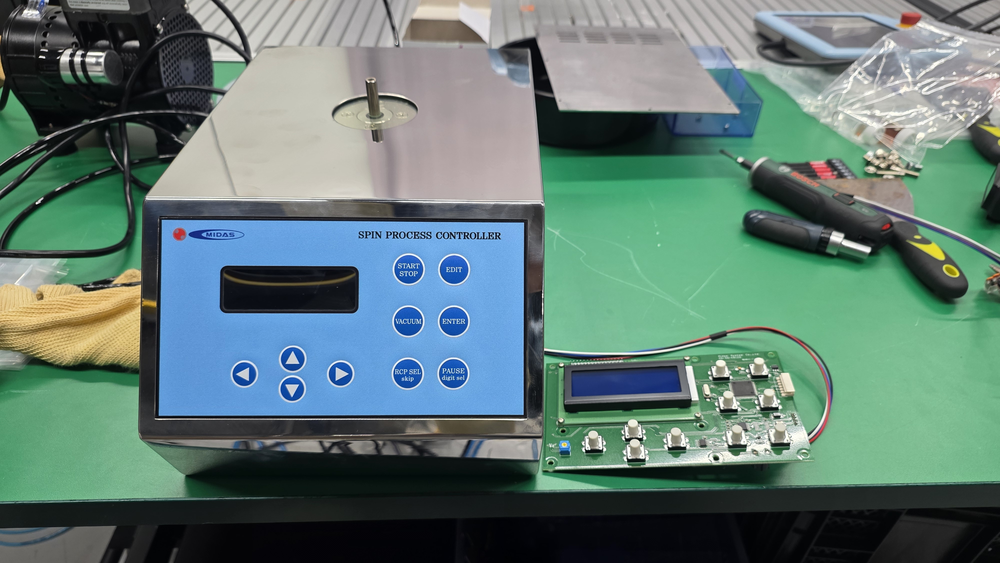
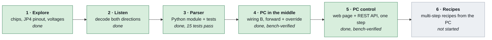
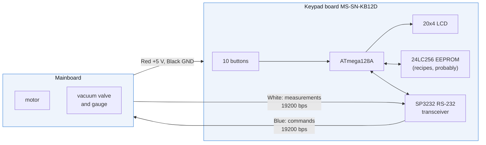
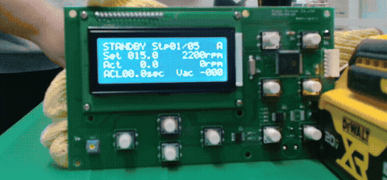
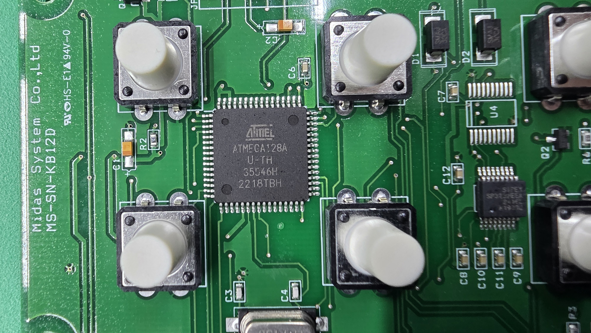
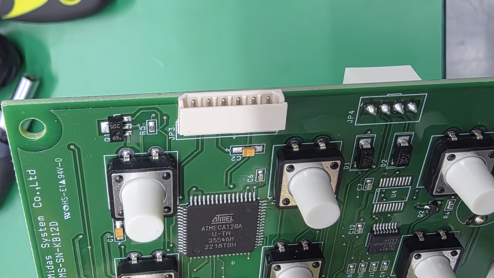
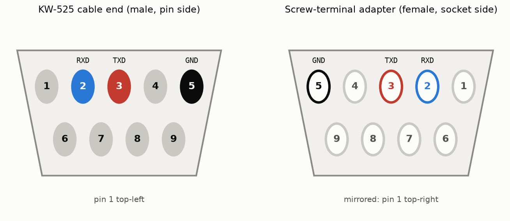
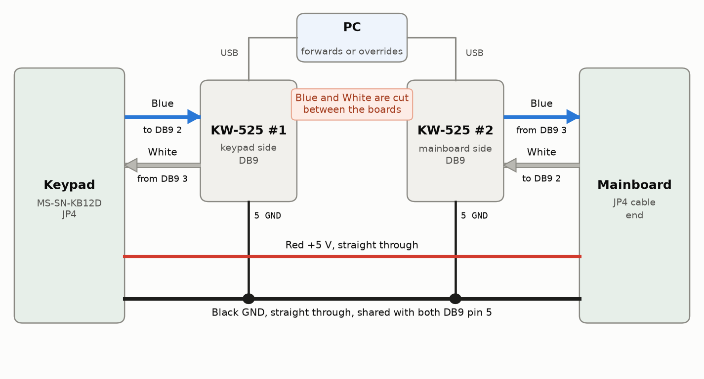
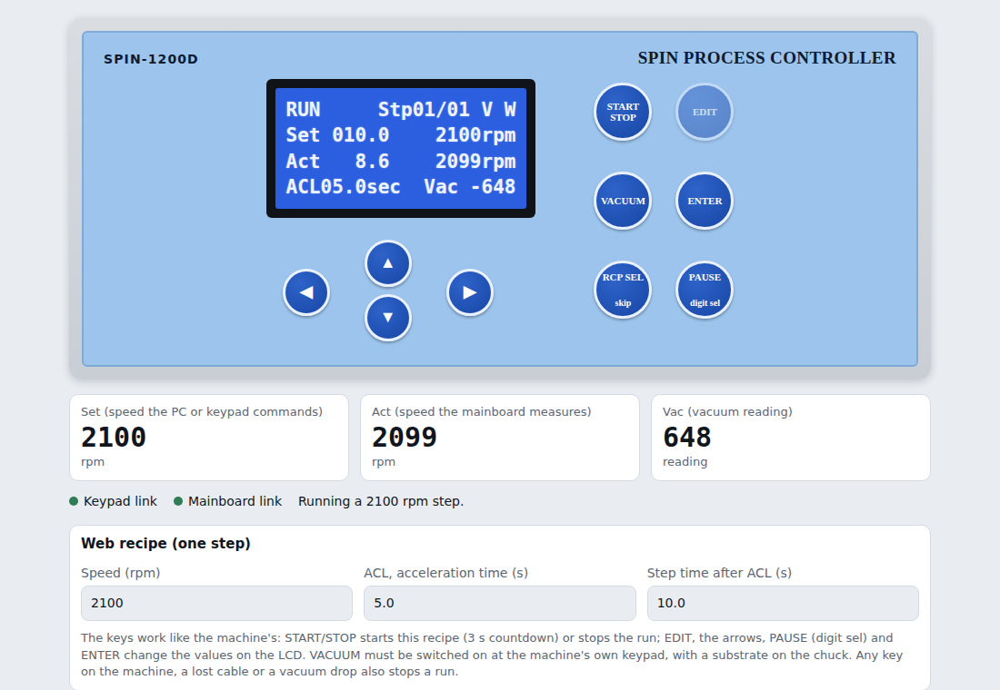
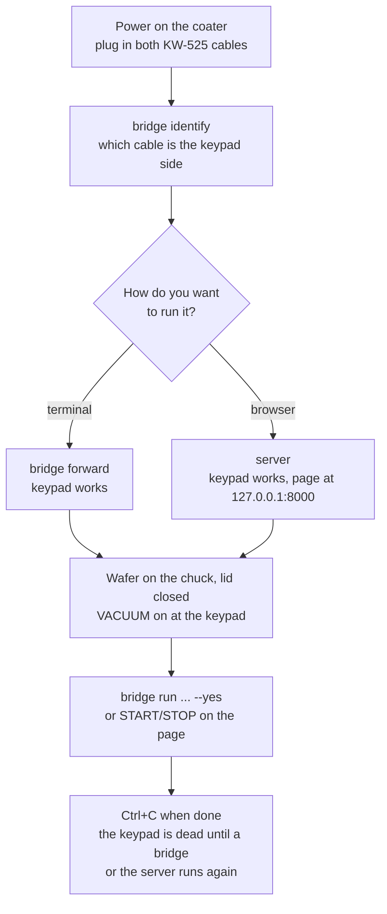

# SpinCoaterAutomationMidas

Driving a **Midas SPIN-1200D** spin coater from a PC. The machine's
front-panel keypad talks to its mainboard over a four-wire serial link;
this project listens to that link, has decoded what both sides say,
and is now putting a PC in the middle so a script can run the coater.

<p align="center">
  
</p>

This README is written for someone who has never used this coater.
It walks through the machine, what was measured, and how the pieces
fit together. Every number below comes from a recording on the bench
(2026-11-17); the raw evidence is linked in each section.

## Contents

1. [Software](#software)
2. [Status](#status)
3. [The machine in one picture](#the-machine-in-one-picture)
4. [Using the coater by hand](#using-the-coater-by-hand)
5. [Inside the keypad](#inside-the-keypad)
6. [The JP4 link](#the-jp4-link)
7. [What happens during a run](#what-happens-during-a-run)
8. [Bench setup](#bench-setup)
9. [Web control](#web-control)
10. [Example terminal session](#example-terminal-session)
11. [Safety rules](#safety-rules)
12. [Open questions](#open-questions)
13. [Glossary](#glossary)
14. [Where to find things](#where-to-find-things)

## Software

The PC sits between the keypad and the mainboard ("wiring B", see
[Bench setup](#bench-setup)). The
[Example terminal session](#example-terminal-session) shows the start
order step by step.

```
spincoater_midas/jp4_protocol.py   frame parser and builder (both directions)
spincoater_midas/bridge.py         wiring B: listen, forward, run one step
spincoater_midas/profile.py        speed ramp for one step, as the keypad makes it
spincoater_midas/server.py         web page + REST API on top of the bridge
spincoater_midas/web/index.html    the page: a copy of the machine's front panel
tests/                             pytest suite; fixtures are recorded frames
claude_test/rs232_probe/           capture tools and every recording session
claude_test/readme_figures/        script that draws the figures in this README
claude_test/web_gui/               browser script that operated the web page on the bench
docs/                              protocol notes, measurements, photos, media
```

Run the tests:

```sh
python3 -m pytest
```

Decode frames in Python:

```python
from spincoater_midas import jp4_protocol as jp4

jp4.parse_keypad_frame("C2102D40300073")
# KeypadCommand(speed_rpm=1234, vacuum=True, run=True, ...)

jp4.parse_mainboard_frame("38200D40000065")
# MainboardStatus(vacuum_reading=643, speed_rpm=1232, tail='0000')

jp4.build_keypad_frame(jp4.KeypadCommand(speed_rpm=1234, vacuum=True, run=True))
# b'\x02C2102D40300073\x03'
```

A frame from the keypad also parses as a mainboard frame (both are
twelve hex-looking characters), so always parse by the wire it came
from.

Record a session (listen-only; frames, changes, webcam video with a
clock overlay):

```sh
python3 claude_test/rs232_probe/capture_session.py --seconds 300 --label my_test
```

### Wiring B bridge

```sh
B="python3 -m spincoater_midas.bridge"
$B identify                                   # which cable faces which board
K=/dev/serial/by-id/...   M=/dev/serial/by-id/...
$B --keypad-port $K --mainboard-port $M listen --seconds 30    # writes nothing
$B --keypad-port $K --mainboard-port $M forward --seconds 600  # panel works as before
$B --keypad-port $K --mainboard-port $M --log run.csv \
   run --rpm 2100 --accel 5 --hold 10 --yes                    # operator present
```

`run` keeps forwarding until the keypad shows vacuum on, the spindle
is still and the vacuum reading is at least 400 (a substrate is held),
counts down 3 s, then drives the step. It stops the spindle (speed 0,
run off, vacuum kept on) when the step ends or as soon as:

- a key changes the keypad frame (START/STOP and VACUUM do),
- the keypad or the mainboard sends nothing for 0.5 s,
- the vacuum reading falls below `--min-vacuum` (default 400),
- the operator presses Ctrl+C.

`--start-vacuum` sets the reading needed to start, if it should be
higher than the stop limit. After a run, the bridge holds the spindle
at 0 rpm until the keypad is idle, so a keypad recipe started during
the run does not take over.

Mainboard frames keep reaching the keypad during a run, but the keypad
does not know the PC is running, so its LCD stays on STANDBY with
`Act 0rpm`; only the vacuum value follows. Watch the speed on the PC.

Bench results on 2026-11-17 (logs in
`claude_test/rs232_probe/sessions/`):

| Test | Result |
|---|---|
| `forward`, 30 s, STANDBY | 394 frames each way, 0 bad; LCD normal |
| `forward`, keypad runs 1234 rpm, ACL 5 s, 5 s | Ramp 4.91 s, hold 1230-1234 rpm, stop 0.41 s; same as without the PC |
| `run --rpm 2100 --accel 5 --hold 10` | Command at 2100 rpm after 4.94 s; measured 2098 rpm mean (2097-2099) for 9.96 s; 0 rpm 0.49 s after the step; vacuum 640-645; 0 bad frames |
| Abort: START/STOP pressed at 500 rpm | Stop frame in the same poll; 493 to 31 rpm in 0.25 s; spindle held at 0 rpm while the keypad's own recipe ran |
| Abort: keypad-side DB9 pulled at 500 rpm | Detected 0.50 s after the last frame; 0 rpm 0.30 s later |
| Abort: vacuum below the limit (`--min-vacuum 643`) | Stopped in the same poll as a 642 reading (194 rpm) |
| Abort: mainboard-side DB9 pulled at 300 rpm | Detected after 0.5 s; the mainboard stopped the spindle by itself, vacuum held |
| PC down: bridge killed at 300 rpm | Mainboard stopped the spindle by itself, vacuum held |

With the PC forwarding, the keypad polls about 14 times a second
instead of 19, because each reply takes about 42 ms through the PC.
The keypad's own ramp is timed by the clock, so recipes still run to
time.

## Status



The PC now runs the coater through wiring B: from the terminal
(`bridge run`) or from a web page (`server`). Every number in this
README comes from a run on the bench with the operator present.

## The machine in one picture

The coater is two boards joined by one four-wire cable (header **JP4**
on the keypad board). The keypad board is not a dumb button matrix: it
has its own microcontroller, draws the LCD, stores recipes and
generates the speed ramp. The mainboard drives the motor and the
vacuum, and reports what it measures.



## Using the coater by hand

The front panel has ten buttons:

| Group | Buttons |
|---|---|
| Right block | START/STOP, EDIT, VACUUM, ENTER, RCP SEL (skip), PAUSE (digit sel) |
| Arrows | Left, Up, Down, Right |

The LCD has four lines. This is the idle screen:

```
STANDBY Stp01/05 V A     machine state · step 1 of 5 · V = vacuum on · recipe A
Set 015.0    2100rpm     step time in seconds · set speed
Act   0.0       0rpm     time counter · actual speed
ACL00.0sec  Vac -000     acceleration (ramp) time · vacuum reading
```

States seen so far: `STANDBY`, `EDIT`, `RUN`, `END`.

A run as performed on the bench:

1. Put the substrate on the chuck.
2. Press **VACUUM**. The `V` appears and `Vac` climbs (about -642 with
   a wafer, about -163 with an empty chuck).
3. Press **START**. The LCD shows `RUN`; `ACL` counts down while the
   speed ramps, then `Act` counts the step time down.
4. The LCD shows `END` when the last step is done.
5. Press **VACUUM** again to release the substrate.

> **Every step in the recipe runs.** The first test run used a recipe
> with five steps (`Stp01/05`) and all five ran. Check the step count
> on the top line before pressing START. A step with `Set 0000rpm` did
> **not** stop the chuck: it kept spinning at the previous speed.

Editing values, deleting steps and the RCP SEL key are described in
[docs/front_panel_operation.md](docs/front_panel_operation.md). Some of
it comes from fragments of the manual and is marked as such.

<p align="center">
  
  <br/><sub>Editing set speed, time and ACL (12x time-lapse).</sub>
</p>

## Inside the keypad

<table>
  <tr>
    <td width="50%"></td>
    <td width="50%"></td>
  </tr>
  <tr>
    <td>ATmega128A, the keypad's own microcontroller.</td>
    <td>JP3 (6-pin, purpose unknown) and JP4 (the 4-wire link).</td>
  </tr>
</table>

| Part | Chip | Role |
|---|---|---|
| Microcontroller | Atmel ATmega128A-AU | Runs the keypad firmware |
| RS-232 transceiver | Sipex SP3232EEA | Turns the MCU's logic levels into RS-232 on JP4 |
| EEPROM | Microchip 24LC256 (32 KB) | Probably recipe storage (not verified) |
| D1, D2 | SMAJ30CA | TVS diodes protecting the link |
| U4 | empty 20-pin footprint | Unknown option |

More photos are in [docs/](docs/).

## The JP4 link

### Wires

Measured with a multimeter, machine on, cable connected
([details](docs/jp4_voltage_measurement.md)):

| Wire | Voltage vs. Black | Role |
|---|---|---|
| Red | +5.0 V | Power for the keypad |
| Black | 0 V | Ground |
| Blue | about -4.4 V at rest | Keypad → mainboard data (traced to SP3232 pin 14, T1OUT) |
| White | about -4.3 V at rest | Mainboard → keypad data |

A resting RS-232 line sits at a negative voltage, which is how the link
was recognised as RS-232. Both data lines run at **19200 bps** and each
side sends a frame about **19 times a second**, all the time.

### Frames

Both directions use the same envelope: `STX`, a body of ASCII
characters, a two-character checksum, `ETX`. The checksum is the sum
of the body bytes modulo 256, in hex. Numbers inside the body are hex
written **lowest digit first**, so they read right to left.


| Direction | Field | Meaning |
|---|---|---|
| Keypad → mainboard | `C` | Command letter, always `C` |
| | digits 1-3 | Always `210`; meaning unknown |
| | digits 4-7 | Commanded speed in rpm |
| | digit 8 | Flags: `2` = vacuum on, `1` = run; `3` = both |
| | digits 9-11 | Always `000` so far |
| Mainboard → keypad | chars 1-4 | Vacuum reading (the LCD shows it negated) |
| | chars 5-8 | Measured speed in rpm |
| | chars 9-12 | Always `0000` so far |

The full write-up with the evidence for each field is
[docs/jp4_protocol.md](docs/jp4_protocol.md).

### Things that surprised us

- **Editing is invisible on the link.** While EDIT mode is open, the
  keypad stops sending entirely. Edited values never appear in STANDBY
  frames either; the keypad keeps them to itself until a run.
- **The `2100` red herring.** The idle frame `C21000000000` looked like
  it carried the 2100 rpm setpoint. It does not: `210` is a constant,
  and the speed field is zero until START.
- **The LCD's `Act rpm` can be wrong.** During steps with
  `Set 0000rpm` the LCD showed `Act 0246rpm` while the mainboard
  reported about 1232 rpm, and the chuck was visibly still spinning.

## What happens during a run


**Top:** speed during a one-step recipe (1234 rpm, ACL 5.0 s, step
5.0 s). The two curves come from two separate runs with the same
recipe step, lined up at START, because the PC could listen to only
one wire at a time.

- The **keypad builds the ramp itself.** It raises the commanded speed
  by 24-25 rpm about every 100 ms and reaches 1234 rpm after 4.9 s.
- The mainboard's measured speed follows the command closely and holds
  1230-1234 rpm.
- **Step time starts after the ramp.** START to stop took 9.9 s:
  5 s of ACL plus 5 s of step time.
- At the end the command drops straight to 0 and the run flag clears.

**Bottom:** the vacuum reading after VACUUM is pressed. With a wafer it
settles at about 643 within 1.5 s; with an empty chuck it only reaches
about 163. Both match what the LCD showed.

<table>
  <tr>
    <td></td>
  </tr>
  <tr>
    <td>LCD through the first run, which ran all five steps of recipe A.</td>
  </tr>
</table>

## Bench setup

| Item | Used as |
|---|---|
| KW-525 USB-RS232 cable (Prolific PL-2303) | Serial port, `/dev/ttyUSB0` |
| Logitech C920 webcam | Records the LCD and buttons, `/dev/video0` |
| DB9 screw-terminal adapter | Joins the cable to the JP4 wires |

The webcam view used for every recording:


### DB9 pins

Only pins 2, 3 and 5 are used. Pin numbers are mirrored between the
cable end and the adapter that plugs into it.



### Three ways to wire it

| Setup | Cables | Blue | White | Red, Black | Keypad works? | PC can command? |
|---|---|---|---|---|---|---|
| A. Listen | 1 or 2 | tap to pin 2 | tap to pin 2 (second cable) | GND to pin 5 | yes | no |
| **B. PC in the middle** | 2 | cut; keypad side to #1 pin 2, mainboard side from #2 pin 3 | cut; mainboard side to #2 pin 2, keypad side from #1 pin 3 | straight through, GND to both pin 5 | yes, through the PC | yes |
| C. PC only | 1 | from pin 3 | to pin 2 | GND to pin 5, Red unused | no (unplugged) | yes |

In setup A the cable's pin 3 must stay disconnected. An RS-232 adapter
normally holds its TXD at the idle level even with the port closed, so
it would fight the transmitter already driving that line.

**Setup B is in use and tested on the machine (2026-11-17).** The PC
forwards
keypad frames to the mainboard and mainboard frames back to the keypad,
so the panel keeps working; to take over, it sends its own frames to
the mainboard instead.



## Web control

`spincoater_midas.server` keeps the bridge running in a background
thread and serves a page that looks like the machine's front panel.
While nobody starts a run it only forwards, so the real keypad works as
usual. START/STOP on the page starts a one-step run after a 3 s
countdown, or stops it.



Start it from the project's `.venv` (see step 1 of the example
session below):

```sh
python3 -m spincoater_midas.server --keypad-port $K --mainboard-port $M \
    --log server.csv
```

Then open `http://127.0.0.1:8000/` in a browser on the same PC; the
automatic API page is at `/docs`. The server listens on this PC only.
`--host 0.0.0.0` would open it to the network (and, inside Docker, the
container's port 8000 must be published), but that has not been
tested.

| Page key | What it does |
|---|---|
| START/STOP | Start the web recipe (3 s countdown); during a countdown or run, stop |
| EDIT, Left/Right, PAUSE (digit sel), Up/Down, ENTER | Edit speed, step time and ACL on the LCD, as on the machine |
| VACUUM | Only shows a note: switch the vacuum on at the machine's keypad, so a person checks the substrate |
| RCP SEL | Only shows a note: the page has one recipe, `W` |

Below the panel, **Set** is the speed being commanded (by the PC
during a web run, by the keypad otherwise), **Act** is the speed the
mainboard measures, and **Vac** is the vacuum reading.

| Endpoint | Body | Result |
|---|---|---|
| `GET /api/status` | | State, Set/Act rpm, vacuum, keypad flags, link health, last result |
| `POST /api/run` | `{"rpm": 2100, "accel": 5, "hold": 10}` | 202 and the status; 409 with the reason if busy, not ready or above the limit; 422 if a value is out of range |
| `POST /api/stop` | | Cancels the countdown or stops the run |

```console
$ curl -s -X POST http://127.0.0.1:8000/api/run -H "Content-Type: application/json" -d '{"rpm": 3000, "accel": 5, "hold": 10}'
{"detail":"3000 rpm is above the 2100 rpm limit"}
```

The speed limit is 2100 rpm by default, the highest speed tried on
this machine; raise it with `--max-rpm`. ACL may be up to 99.9 s and
the step time up to 999.9 s, the longest the keypad's LCD can show.
The gates of `bridge run` apply (keypad vacuum on, vacuum reading at
least `--min-vacuum`, spindle still), and a key on the machine, a lost
cable or a vacuum drop stops a run.

Bench results on 2026-11-17, with the page operated by a headless
browser (`claude_test/web_gui/verify_web_gui.py`):

| Test | Page showed | Machine |
|---|---|---|
| START/STOP on the page; 2100 rpm, ACL 5 s, 10 s | Set 0 to 2100; Act 419, 921, 1427, 1942, then 2099-2100 rpm; END | Act at 99% after 5.16 s, held 10 s, stopped |
| START/STOP pressed again 8 s into a 1000 rpm run | Set 0 at once, Act 0, STANDBY | 999 to 0 rpm within 0.36 s of the click |

## Example terminal session

A full session from a fresh clone to a PC-driven run. Every output
below was copied from a real terminal on the bench PC (2026-11-17);
`$` lines are typed, the rest is printed. The bridge run is the one in
`claude_test/rs232_probe/sessions/20261117_103946_bridge_run_2100rpm/`,
the start-order steps (9-11) are in
`claude_test/rs232_probe/sessions/20261117_114805_start_order/`.

### Start order



1. **Power and cables first.** `identify` can only tell the cables
   apart while the keypad is powered and sending.
2. **`identify` before anything else**, to learn which cable faces
   the keypad. It only reads.
3. **Start exactly one program: the bridge or the server.** Each one
   locks both cables, so a second one stops with "is in use" (step 10).
   With nothing running, the keypad cannot reach the mainboard.
4. **VACUUM at the keypad**, with a substrate on the chuck, then start
   the run from the terminal or the page. The PC never switches the
   vacuum on.
5. **Ctrl+C to stop the program.** The mainboard then keeps the vacuum
   on and stops the spindle by itself; start `forward` or the server
   again to use the keypad.

**1. Get the code and its dependencies.** Ubuntu 24.04 blocks a
system-wide `pip install`, so use a virtual environment. `[test]` adds
pytest, httpx and ruff; the playwright package used by
`claude_test/web_gui/` is not included.

```console
$ git clone https://github.com/coport-uni/SpinCoaterAutomationMidas.git
$ cd SpinCoaterAutomationMidas
$ python3 -m venv .venv && . .venv/bin/activate
$ pip install -e ".[test]"
```

**2. Run the tests.** They need no hardware: the bridge tests use a
simulated keypad and mainboard.

```console
$ python3 -m pytest
============================= test session starts ==============================
platform linux -- Python 3.12.3, pytest-9.2.0, pluggy-1.7.0
rootdir: /workspace/SpinCoaterAutomationMidas
configfile: pyproject.toml
testpaths: tests
plugins: anyio-4.16.0
collected 38 items

tests/test_bridge.py ...............                                     [ 39%]
tests/test_jp4_protocol.py ...............                               [ 78%]
tests/test_server.py ........                                            [100%]

======================== 38 passed, 1 warning in 0.22s =========================
```

(The warning is Starlette's notice that its test client wants
`httpx2`; it does not affect the results.)

**3. See what the bridge can do.**

```console
$ python3 -m spincoater_midas.bridge --help
usage: bridge.py [-h] [--keypad-port KEYPAD_PORT]
                 [--mainboard-port MAINBOARD_PORT] [--log LOG]
                 {identify,listen,forward,run} ...

Put the PC between keypad and mainboard on JP4 (wiring B).

positional arguments:
  {identify,listen,forward,run}
    identify            find which port faces which board
    listen              log both directions, write nothing
    forward             pass frames both ways so the keypad works
    run                 drive one step from the PC

options:
  -h, --help            show this help message and exit
  --keypad-port KEYPAD_PORT
  --mainboard-port MAINBOARD_PORT
  --log LOG             CSV file for every frame and event
```

**4. Find the two cables.** Plug in both KW-525 cables, power the
coater, and let `identify` listen for 2 s. The cable that hears `C`
frames faces the keypad. The other one is silent because the mainboard
only answers the keypad, and nothing is forwarding yet.

```console
$ ls /dev/serial/by-id/
usb-Prolific_Technology_Inc._USB-Serial_Controller_AUCGb144J08-if00-port0
usb-Prolific_Technology_Inc._USB-Serial_Controller_BHCWb144J08-if00-port0
$ python3 -m spincoater_midas.bridge identify
silent    /dev/serial/by-id/usb-Prolific_Technology_Inc._USB-Serial_Controller_AUCGb144J08-if00-port0
keypad    /dev/serial/by-id/usb-Prolific_Technology_Inc._USB-Serial_Controller_BHCWb144J08-if00-port0
$ K=/dev/serial/by-id/usb-Prolific_Technology_Inc._USB-Serial_Controller_BHCWb144J08-if00-port0
$ M=/dev/serial/by-id/usb-Prolific_Technology_Inc._USB-Serial_Controller_AUCGb144J08-if00-port0
```

**5. Listen without sending anything.** With no PC forwarding, the
keypad gets no answer and retries about every 2.1 s, so 5 s gives only
three frames and no mainboard status.

```console
$ python3 -m spincoater_midas.bridge --keypad-port $K --mainboard-port $M \
      --log listen.csv listen --seconds 5
bad frames: 0; last mainboard status: None
$ cat listen.csv
monotonic,event,detail
1982673.688,wall_clock,2026-11-17 10:48:31.503939
1982673.764,keypad_rx,C2100000000056
1982675.865,keypad_rx,C2100000000056
1982677.965,keypad_rx,C2100000000056
```

**6. Forward, so the keypad works as before.** Use the panel normally
while this runs; give a long `--seconds` for a working session.

```console
$ python3 -m spincoater_midas.bridge --keypad-port $K --mainboard-port $M \
      --log forward.csv forward --seconds 30
bad frames: 0; last mainboard status: MainboardStatus(vacuum_reading=0, speed_rpm=0, tail='0000')
```

**7. Let the PC run one step.** Put a wafer on the chuck, close the
lid, and keep the e-stop in reach. Start the command, then press
**VACUUM** (only VACUUM) on the keypad. The PC waits up to 60 s for
the vacuum to hold a substrate, counts down 3 s, ramps to 2100 rpm in
5 s, holds 10 s, and stops. A key press, a silent link or a vacuum
drop during the run stops the spindle; each of these was tried on the
machine (see the abort tests under [Wiring B bridge](#wiring-b-bridge)).

```console
$ python3 -m spincoater_midas.bridge --keypad-port $K --mainboard-port $M \
      --log run.csv run --rpm 2100 --accel 5 --hold 10 --yes
not ready: no frames from the keypad
not ready: vacuum is off (press VACUUM on the keypad)
not ready: vacuum reading 176 is below 400 (is a substrate on the chuck?)
starting in 3 s (Ctrl+C to cancel)
starting in 2 s (Ctrl+C to cancel)
starting in 1 s (Ctrl+C to cancel)
step completed; peak measured 2100 rpm
bad frames: 0; last mainboard status: MainboardStatus(vacuum_reading=642, speed_rpm=0, tail='0000')
```

(The `not ready` lines repeat every 0.5 s while waiting; duplicates
are removed here.) The step ends with speed 0 and the vacuum still on.
Start `forward` again and press VACUUM to release the wafer: while no
bridge is running the keypad cannot reach the mainboard, and the
mainboard keeps its last command.

**8. Read the log.** Every frame is one CSV row; decode it with the
parser. (On the bench the log was `bridge.csv` in the session folder.)

```console
$ grep -m1 run_start run.csv
1982193.781,run_start,"StepProfile(target_rpm=2100, acceleration_seconds=5.0, hold_seconds=10.0)"
$ grep run_end run.csv
1982209.283,run_end,step completed
$ python3 -c 'from spincoater_midas import jp4_protocol as jp4
print(jp4.parse_mainboard_frame("38209C70000070"))'
MainboardStatus(vacuum_reading=643, speed_rpm=1993, tail='0000')
```

**9. Or start the web server instead of the bridge.** It forwards on
its own, so the keypad works while it runs. Open
`http://127.0.0.1:8000/` and use START/STOP on the page.

```console
$ python3 -m spincoater_midas.server --keypad-port $K --mainboard-port $M
INFO:     Started server process [202027]
INFO:     Waiting for application startup.
INFO:     Application startup complete.
INFO:     Uvicorn running on http://127.0.0.1:8000 (Press CTRL+C to quit)
```

In a second terminal:

```console
$ curl -s http://127.0.0.1:8000/api/status
{"state":"forwarding","countdown_seconds":null,"elapsed_seconds":null,"profile":null,"set_rpm":0,"act_rpm":0,"vacuum_reading":0,"keypad":{"vacuum":false,"run":false,"speed_rpm":0},"links":{"keypad":true,"mainboard":true},"ready_problem":"vacuum is off (press VACUUM on the keypad)","last_result":null,"bad_frames":0,"limits":{"max_rpm":2100,"min_vacuum":400,"start_vacuum":400}}
```

**10. Only one program at a time.** While the server runs, the cables
are locked:

```console
$ python3 -m spincoater_midas.bridge identify
busy      /dev/serial/by-id/usb-Prolific_Technology_Inc._USB-Serial_Controller_AUCGb144J08-if00-port0
busy      /dev/serial/by-id/usb-Prolific_Technology_Inc._USB-Serial_Controller_BHCWb144J08-if00-port0
$ python3 -m spincoater_midas.bridge --keypad-port $K --mainboard-port $M forward --seconds 5
error: /dev/serial/by-id/usb-Prolific_Technology_Inc._USB-Serial_Controller_BHCWb144J08-if00-port0 is in use; is the bridge or the server already running?
$ python3 -m spincoater_midas.server --keypad-port $K --mainboard-port $M --port 8001
error: /dev/serial/by-id/usb-Prolific_Technology_Inc._USB-Serial_Controller_BHCWb144J08-if00-port0 is in use; is the bridge or the server already running?
```

**11. Stop the server with Ctrl+C.** The cables are free again:

```console
INFO:     127.0.0.1:47926 - "GET /api/status HTTP/1.1" 200 OK
^C
INFO:     Shutting down
INFO:     Waiting for application shutdown.
INFO:     Application shutdown complete.
INFO:     Finished server process [202027]
bad frames: 0
$ python3 -m spincoater_midas.bridge identify
silent    /dev/serial/by-id/usb-Prolific_Technology_Inc._USB-Serial_Controller_AUCGb144J08-if00-port0
keypad    /dev/serial/by-id/usb-Prolific_Technology_Inc._USB-Serial_Controller_BHCWb144J08-if00-port0
```

## Safety rules

- **Never connect an RS-232 line to a 3.3 V or 5 V microcontroller
  pin.** The data lines swing to about ±5 V.
- **The operator starts every run, and stays at the machine.** With
  the keypad, that is START. With `bridge run`, it is the operator
  turning VACUUM on: the PC starts 3 s after the vacuum holds a
  substrate. No script switches vacuum or power on its own.
- **Check the recipe's step count before START.** All steps run.
- **Lid closed, e-stop within reach** for every run.
- **In setup B the PC sits between the STOP key and the motor.** If the
  PC program hangs, the keypad's STOP no longer reaches the mainboard.
  Before relying on B, confirm that the e-stop cuts the motor without
  help from the link, and find out what the mainboard does when frames
  stop arriving.
- **In setup B the panel is dead whenever the bridge is not running.**
  The mainboard stops the spindle by itself when frames stop, but keeps
  the vacuum on until a frame says otherwise. Leave `forward` running
  whenever the operator should use the keypad.
- **START and STOP are one key.** Pressing it during a PC run starts the
  keypad's own recipe. The bridge stops the PC run and then holds the
  spindle at 0 rpm until the keypad's recipe ends; it never hands the
  spindle to a recipe it did not see start.

## Open questions

- How long does the mainboard wait before it stops the spindle when
  frames stop? It does stop by itself and keeps the vacuum (bench,
  2026-11-17), but it sends nothing meanwhile, so the delay is not
  measured.
- Meaning of the keypad's constant `210` and of the always-zero fields.
- Why the LCD showed `Act 0246rpm` while the speed was about 1232 rpm.
- White to SP3232 pin 13 was not traced by continuity (it was inferred
  as the only remaining data wire).
- Line parity: 8N1 is assumed; 7-bit ASCII cannot rule out 8E1/8O1.
- Is there a lid interlock, and does it appear on the link?

## Glossary

| Term | Meaning |
|---|---|
| Spin coater | Spins a substrate fast so a liquid on it spreads into a thin film |
| Chuck | The disc the substrate sits on; holds it by vacuum |
| ACL | Acceleration time: how long the ramp to the set speed takes |
| Step / recipe | A recipe is a list of steps (speed, time, ACL); seller spec sheets list 20 recipes and 50 steps |
| RS-232 | A serial standard that uses about ±5-15 V; "idle" is negative |
| STX / ETX | Start-of-text (0x02) and end-of-text (0x03) bytes framing each message |
| Checksum | Two hex characters that let the receiver detect a corrupted frame |

## Where to find things

| Document | Contents |
|---|---|
| [docs/jp4_protocol.md](docs/jp4_protocol.md) | Protocol notes and evidence, field by field |
| [docs/jp4_voltage_measurement.md](docs/jp4_voltage_measurement.md) | Multimeter readings on JP4 |
| [docs/front_panel_operation.md](docs/front_panel_operation.md) | Panel keys, editing, deleting steps |
| [docs/media/index.md](docs/media/index.md) | Every recorded video and still, with times |
| [claude_test/README.md](claude_test/README.md) | Index of capture tools and sessions |
| [ToDo.md](ToDo.md) | Task history |

Related project: the similar approach on a Laurell spin coater,
[SpinCoaterAutomationLaurell](https://github.com/coport-uni/SpinCoaterAutomationLaurell).
