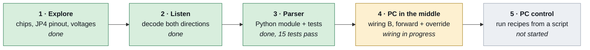
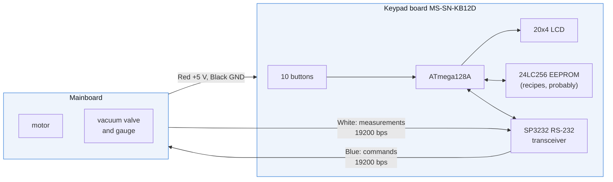
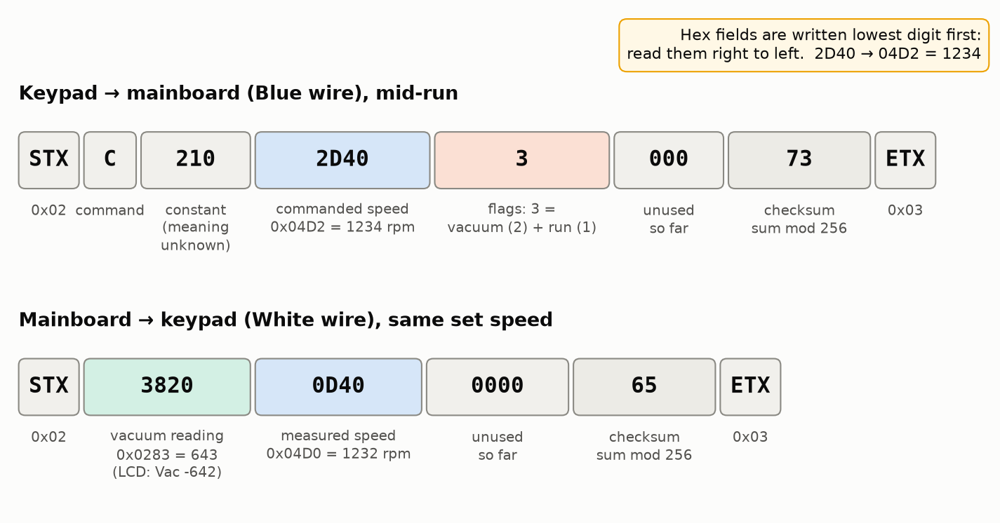
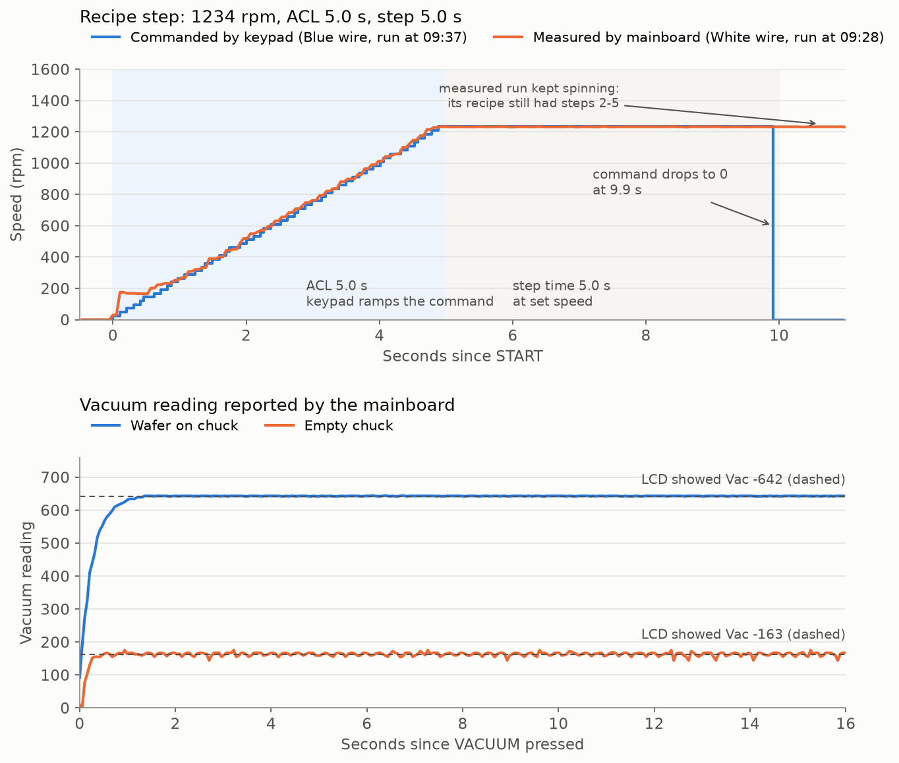
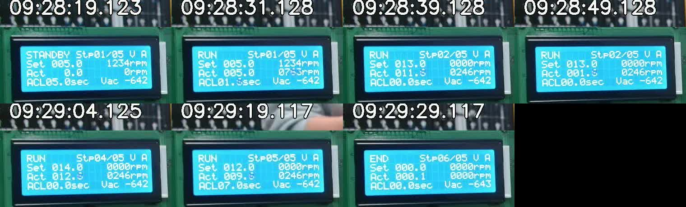
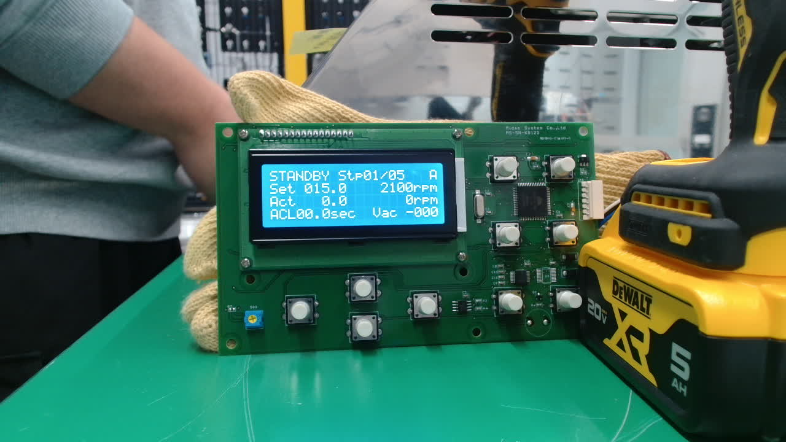

# SpinCoaterAutomationMidas

Driving a **Midas SPIN-1200D** spin coater from a PC. The machine's
front-panel keypad talks to its mainboard over a four-wire serial link;
this project listens to that link, has decoded what both sides say,
and is now putting a PC in the middle so a script can run the coater.

<p align="center">
  
</p>

This README is written for someone who has never used this coater.
It walks through the machine, what was measured, and how the pieces
fit together. Every number below comes from a recording on the bench
(2026-11-17); the raw evidence is linked in each section.

## Contents

1. [Status](#status)
2. [The machine in one picture](#the-machine-in-one-picture)
3. [Using the coater by hand](#using-the-coater-by-hand)
4. [Inside the keypad](#inside-the-keypad)
5. [The JP4 link](#the-jp4-link)
6. [What happens during a run](#what-happens-during-a-run)
7. [Bench setup](#bench-setup)
8. [Software](#software)
9. [Safety rules](#safety-rules)
10. [Open questions](#open-questions)
11. [Glossary](#glossary)
12. [Where to find things](#where-to-find-things)

## Status



**Nothing has been sent from the PC to the machine yet.** Every
recording so far was listen-only.

## The machine in one picture

The coater is two boards joined by one four-wire cable (header **JP4**
on the keypad board). The keypad board is not a dumb button matrix: it
has its own microcontroller, draws the LCD, stores recipes and
generates the speed ramp. The mainboard drives the motor and the
vacuum, and reports what it measures.



## Using the coater by hand

The front panel has ten buttons:

| Group | Buttons |
|---|---|
| Right block | START/STOP, EDIT, VACUUM, ENTER, RCP SEL (skip), PAUSE (digit sel) |
| Arrows | Left, Up, Down, Right |

The LCD has four lines. This is the idle screen:

```
STANDBY Stp01/05 V A     machine state · step 1 of 5 · V = vacuum on · recipe A
Set 015.0    2100rpm     step time in seconds · set speed
Act   0.0       0rpm     time counter · actual speed
ACL00.0sec  Vac -000     acceleration (ramp) time · vacuum reading
```

States seen so far: `STANDBY`, `EDIT`, `RUN`, `END`.

A run as performed on the bench:

1. Put the substrate on the chuck.
2. Press **VACUUM**. The `V` appears and `Vac` climbs (about -642 with
   a wafer, about -163 with an empty chuck).
3. Press **START**. The LCD shows `RUN`; `ACL` counts down while the
   speed ramps, then `Act` counts the step time down.
4. The LCD shows `END` when the last step is done.
5. Press **VACUUM** again to release the substrate.

> **Every step in the recipe runs.** The first test run used a recipe
> with five steps (`Stp01/05`) and all five ran. Check the step count
> on the top line before pressing START. A step with `Set 0000rpm` did
> **not** stop the chuck: it kept spinning at the previous speed.

Editing values, deleting steps and the RCP SEL key are described in
[docs/front_panel_operation.md](docs/front_panel_operation.md). Some of
it comes from fragments of the manual and is marked as such.

<p align="center">
  
  <br/><sub>Editing set speed, time and ACL (12x time-lapse).</sub>
</p>

## Inside the keypad

<table>
  <tr>
    <td width="50%"></td>
    <td width="50%"></td>
  </tr>
  <tr>
    <td>ATmega128A, the keypad's own microcontroller.</td>
    <td>JP3 (6-pin, purpose unknown) and JP4 (the 4-wire link).</td>
  </tr>
</table>

| Part | Chip | Role |
|---|---|---|
| Microcontroller | Atmel ATmega128A-AU | Runs the keypad firmware |
| RS-232 transceiver | Sipex SP3232EEA | Turns the MCU's logic levels into RS-232 on JP4 |
| EEPROM | Microchip 24LC256 (32 KB) | Probably recipe storage (not verified) |
| D1, D2 | SMAJ30CA | TVS diodes protecting the link |
| U4 | empty 20-pin footprint | Unknown option |

More photos are in [docs/](docs/).

## The JP4 link

### Wires

Measured with a multimeter, machine on, cable connected
([details](docs/jp4_voltage_measurement.md)):

| Wire | Voltage vs. Black | Role |
|---|---|---|
| Red | +5.0 V | Power for the keypad |
| Black | 0 V | Ground |
| Blue | about -4.4 V at rest | Keypad → mainboard data (traced to SP3232 pin 14, T1OUT) |
| White | about -4.3 V at rest | Mainboard → keypad data |

A resting RS-232 line sits at a negative voltage, which is how the link
was recognised as RS-232. Both data lines run at **19200 bps** and each
side sends a frame about **19 times a second**, all the time.

### Frames

Both directions use the same envelope: `STX`, a body of ASCII
characters, a two-character checksum, `ETX`. The checksum is the sum
of the body bytes modulo 256, in hex. Numbers inside the body are hex
written **lowest digit first**, so they read right to left.



| Direction | Field | Meaning |
|---|---|---|
| Keypad → mainboard | `C` | Command letter, always `C` |
| | digits 1-3 | Always `210`; meaning unknown |
| | digits 4-7 | Commanded speed in rpm |
| | digit 8 | Flags: `2` = vacuum on, `1` = run; `3` = both |
| | digits 9-11 | Always `000` so far |
| Mainboard → keypad | chars 1-4 | Vacuum reading (the LCD shows it negated) |
| | chars 5-8 | Measured speed in rpm |
| | chars 9-12 | Always `0000` so far |

The full write-up with the evidence for each field is
[docs/jp4_protocol.md](docs/jp4_protocol.md).

### Things that surprised us

- **Editing is invisible on the link.** While EDIT mode is open, the
  keypad stops sending entirely. Edited values never appear in STANDBY
  frames either; the keypad keeps them to itself until a run.
- **The `2100` red herring.** The idle frame `C21000000000` looked like
  it carried the 2100 rpm setpoint. It does not: `210` is a constant,
  and the speed field is zero until START.
- **The LCD's `Act rpm` can be wrong.** During steps with
  `Set 0000rpm` the LCD showed `Act 0246rpm` while the mainboard
  reported about 1232 rpm, and the chuck was visibly still spinning.

## What happens during a run



**Top:** speed during a one-step recipe (1234 rpm, ACL 5.0 s, step
5.0 s). The two curves come from two separate runs with the same
recipe step, lined up at START, because the PC could listen to only
one wire at a time.

- The **keypad builds the ramp itself.** It raises the commanded speed
  by 24-25 rpm about every 100 ms and reaches 1234 rpm after 4.9 s.
- The mainboard's measured speed follows the command closely and holds
  1230-1234 rpm.
- **Step time starts after the ramp.** START to stop took 9.9 s:
  5 s of ACL plus 5 s of step time.
- At the end the command drops straight to 0 and the run flag clears.

**Bottom:** the vacuum reading after VACUUM is pressed. With a wafer it
settles at about 643 within 1.5 s; with an empty chuck it only reaches
about 163. Both match what the LCD showed.

<table>
  <tr>
    <td></td>
  </tr>
  <tr>
    <td>LCD through the first run, which ran all five steps of recipe A.</td>
  </tr>
</table>

## Bench setup

| Item | Used as |
|---|---|
| KW-525 USB-RS232 cable (Prolific PL-2303) | Serial port, `/dev/ttyUSB0` |
| Logitech C920 webcam | Records the LCD and buttons, `/dev/video0` |
| DB9 screw-terminal adapter | Joins the cable to the JP4 wires |

The webcam view used for every recording:



### DB9 pins

Only pins 2, 3 and 5 are used. Pin numbers are mirrored between the
cable end and the adapter that plugs into it.


### Three ways to wire it

| Setup | Cables | Blue | White | Red, Black | Keypad works? | PC can command? |
|---|---|---|---|---|---|---|
| A. Listen | 1 or 2 | tap to pin 2 | tap to pin 2 (second cable) | GND to pin 5 | yes | no |
| **B. PC in the middle** | 2 | cut; keypad side to #1 pin 2, mainboard side from #2 pin 3 | cut; mainboard side to #2 pin 2, keypad side from #1 pin 3 | straight through, GND to both pin 5 | yes, through the PC | yes |
| C. PC only | 1 | from pin 3 | to pin 2 | GND to pin 5, Red unused | no (unplugged) | yes |

In setup A the cable's pin 3 must stay disconnected. An RS-232 adapter
normally holds its TXD at the idle level even with the port closed, so
it would fight the transmitter already driving that line.

**Setup B is being wired now (not yet tested).** The PC forwards
keypad frames to the mainboard and mainboard frames back to the keypad,
so the panel keeps working; to take over, it sends its own frames to
the mainboard instead.


## Software

```
spincoater_midas/jp4_protocol.py   frame parser and builder (both directions)
tests/                             pytest suite; fixtures are recorded frames
claude_test/rs232_probe/           capture tools and every recording session
claude_test/readme_figures/        script that draws the figures in this README
docs/                              protocol notes, measurements, photos, media
```

Run the tests:

```sh
python3 -m pytest
```

Decode frames in Python:

```python
from spincoater_midas import jp4_protocol as jp4

jp4.parse_keypad_frame("C2102D40300073")
# KeypadCommand(speed_rpm=1234, vacuum=True, run=True, ...)

jp4.parse_mainboard_frame("38200D40000065")
# MainboardStatus(vacuum_reading=643, speed_rpm=1232, tail='0000')

jp4.build_keypad_frame(jp4.KeypadCommand(speed_rpm=1234, vacuum=True, run=True))
# b'\x02C2102D40300073\x03'
```

A frame from the keypad also parses as a mainboard frame (both are
twelve hex-looking characters), so always parse by the wire it came
from.

Record a session (listen-only; frames, changes, webcam video with a
clock overlay):

```sh
python3 claude_test/rs232_probe/capture_session.py --seconds 300 --label my_test
```

## Safety rules

- **Never connect an RS-232 line to a 3.3 V or 5 V microcontroller
  pin.** The data lines swing to about ±5 V.
- **The operator presses START, and stays at the machine.** No script
  starts motion, vacuum or power switching on its own.
- **Check the recipe's step count before START.** All steps run.
- **Lid closed, e-stop within reach** for every run.
- **In setup B the PC sits between the STOP key and the motor.** If the
  PC program hangs, the keypad's STOP no longer reaches the mainboard.
  Before relying on B, confirm that the e-stop cuts the motor without
  help from the link, and find out what the mainboard does when frames
  stop arriving.

## Open questions

- What does the mainboard do when the keypad's frames stop mid-run?
  (Needed before any PC control.)
- Meaning of the keypad's constant `210` and of the always-zero fields.
- Why the LCD showed `Act 0246rpm` while the speed was about 1232 rpm.
- White to SP3232 pin 13 was not traced by continuity (it was inferred
  as the only remaining data wire).
- Line parity: 8N1 is assumed; 7-bit ASCII cannot rule out 8E1/8O1.
- Is there a lid interlock, and does it appear on the link?

## Glossary

| Term | Meaning |
|---|---|
| Spin coater | Spins a substrate fast so a liquid on it spreads into a thin film |
| Chuck | The disc the substrate sits on; holds it by vacuum |
| ACL | Acceleration time: how long the ramp to the set speed takes |
| Step / recipe | A recipe is a list of steps (speed, time, ACL); seller spec sheets list 20 recipes and 50 steps |
| RS-232 | A serial standard that uses about ±5-15 V; "idle" is negative |
| STX / ETX | Start-of-text (0x02) and end-of-text (0x03) bytes framing each message |
| Checksum | Two hex characters that let the receiver detect a corrupted frame |

## Where to find things

| Document | Contents |
|---|---|
| [docs/jp4_protocol.md](docs/jp4_protocol.md) | Protocol notes and evidence, field by field |
| [docs/jp4_voltage_measurement.md](docs/jp4_voltage_measurement.md) | Multimeter readings on JP4 |
| [docs/front_panel_operation.md](docs/front_panel_operation.md) | Panel keys, editing, deleting steps |
| [docs/media/index.md](docs/media/index.md) | Every recorded video and still, with times |
| [claude_test/README.md](claude_test/README.md) | Index of capture tools and sessions |
| [ToDo.md](ToDo.md) | Task history |

Related project: the same approach on a Laurell spin coater,
[SpinCoaterAutomationLaurell](https://github.com/coport-uni/SpinCoaterAutomationLaurell).
